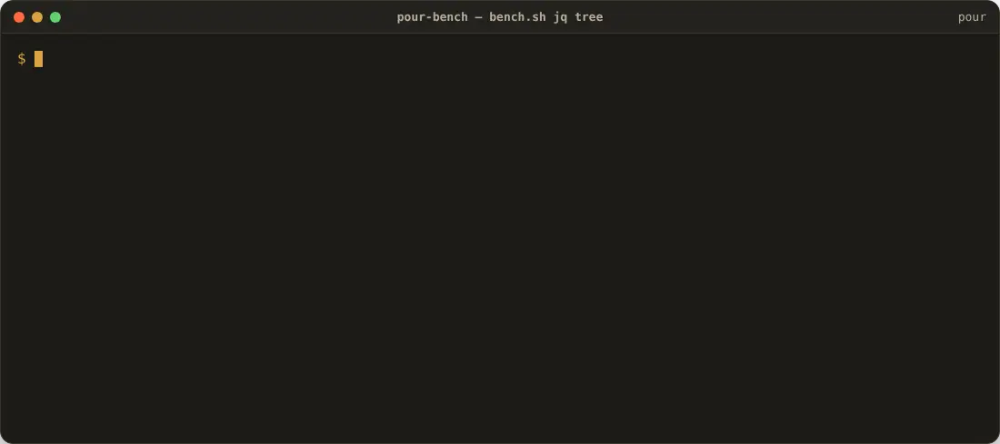
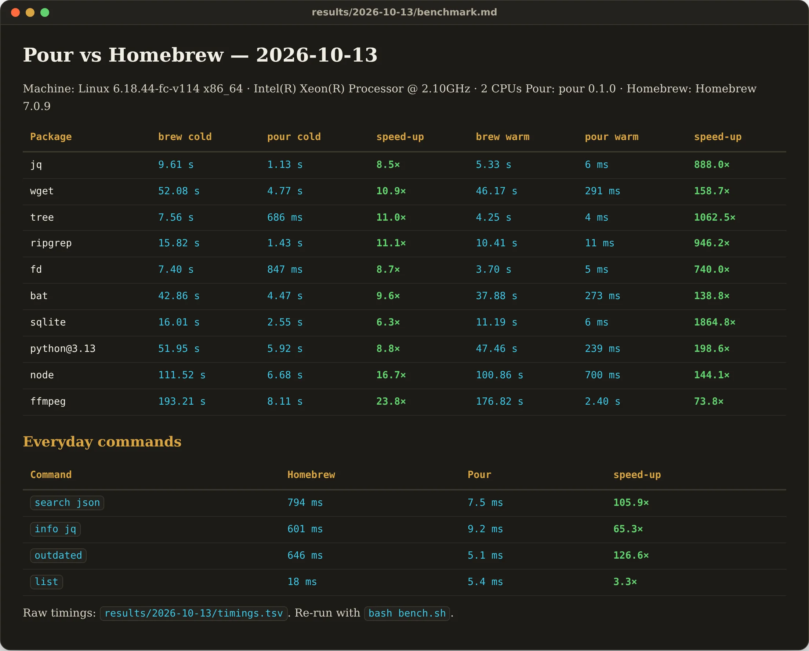
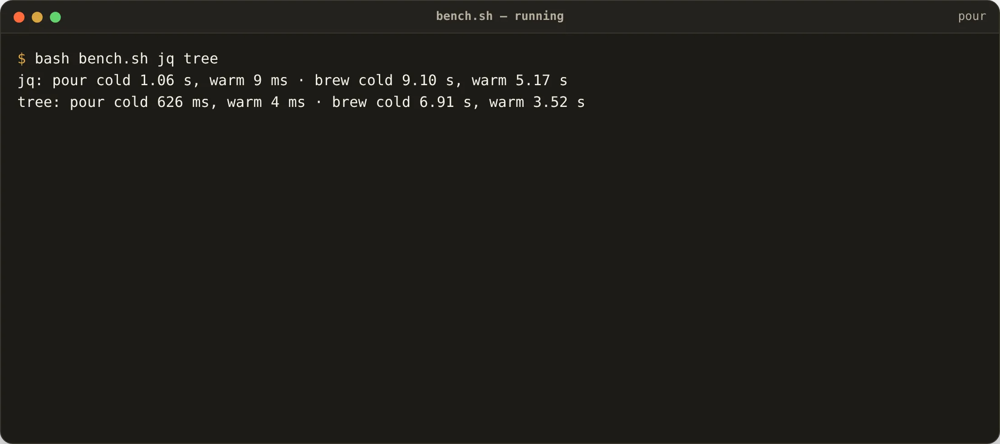

<p align="center">
  <picture>
    <source media="(prefers-color-scheme: dark)" srcset="docs/pour-dark.svg">
    
  </picture>
</p>

<h1 align="center">pour-bench</h1>

<p align="center"><strong><a href="https://github.com/JKS-sys/pour-13-Oct-2026">Pour</a> against Homebrew, on the same machine, with the script that produced every number.</strong></p>

```sh
bash bench.sh                    # the default set, brew and pour side by side
bash bench.sh jq ffmpeg          # your own set
POUR_ONLY=1 bash bench.sh        # no Homebrew on this machine
```

> ⭐ **If Pour saves you time, star this repository** — stars are how other people find it.

## Protocol

Every run starts from nothing, so the comparison is honest:

- **cold** — nothing installed in that manager and its download cache empty; the time is the package *and its whole dependency tree*.
- **warm** — nothing installed, but the downloads from the cold run are still cached (Homebrew keeps the bottle; Pour keeps the bottle and the unpacked, relocated keg in its store).
- Both tools run their post-install steps. Both get the newest index before the run. No numbers are typed in by hand: `bench.sh` writes `results/<date>/benchmark.md` and the raw `timings.tsv`.
- Times come from bash's own `time` keyword, so nothing is started to read the clock and a 4 ms command is reported as 4 ms. The everyday commands are means: 3 runs for Homebrew, 20 for Pour.

Cold installs are mostly your connection; warm installs are where the architecture shows (a warm Pour install is an APFS clone or a symlink, a few links and a receipt).

## Results

<!-- results:start -->
Machine: Linux 6.18.44-fc-v114 x86_64 · Intel(R) Xeon(R) Processor @ 2.10GHz · 2 CPUs
Pour: pour 0.1.0 · Homebrew: Homebrew 7.0.9

| Package | brew cold | pour cold | speed-up | brew warm | pour warm | speed-up |
|---|---|---|---|---|---|---|
| jq | 9.61 s | 1.13 s | 8.5× | 5.33 s | 6 ms | 888.0× |
| wget | 52.08 s | 4.77 s | 10.9× | 46.17 s | 291 ms | 158.7× |
| tree | 7.56 s | 686 ms | 11.0× | 4.25 s | 4 ms | 1062.5× |
| ripgrep | 15.82 s | 1.43 s | 11.1× | 10.41 s | 11 ms | 946.2× |
| fd | 7.40 s | 847 ms | 8.7× | 3.70 s | 5 ms | 740.0× |
| bat | 42.86 s | 4.47 s | 9.6× | 37.88 s | 273 ms | 138.8× |
| sqlite | 16.01 s | 2.55 s | 6.3× | 11.19 s | 6 ms | 1864.8× |
| python@3.13 | 51.95 s | 5.92 s | 8.8× | 47.46 s | 239 ms | 198.6× |
| node | 111.52 s | 6.68 s | 16.7× | 100.86 s | 700 ms | 144.1× |
| ffmpeg | 193.21 s | 8.11 s | 23.8× | 176.82 s | 2.40 s | 73.8× |

## Everyday commands

| Command | Homebrew | Pour | speed-up |
|---|---|---|---|
| `search json` | 794 ms | 7.5 ms | 105.9× |
| `info jq` | 601 ms | 9.2 ms | 65.3× |
| `outdated` | 646 ms | 5.1 ms | 126.6× |
| `list` | 18 ms | 5.4 ms | 3.3× |

Raw timings: `results/2026-10-13/timings.tsv`. Re-run with `bash bench.sh`.
<!-- results:end -->

## See it move



[▶ Watch with sound (MP4)](docs/demo-bench.mp4)

<table>
<tr>
<td><br><sub>The table `bench.sh` writes — cold and warm, both tools, speed-ups computed from the raw timings.</sub></td>
<td><br><sub>A run in progress: one package at a time, brew first, then pour, each from a clean state.</sub></td>
</tr>
</table>

## Reading the numbers

- `pour info` and `pour search` answer from a memory-mapped index in 5–10 ms, process start included; `brew` boots Ruby first and takes 0.6–0.8 s. That gap (65–125× here) is per command, every time you type one.
- Warm installs of small tools are 700–1,900× faster here (4–11 ms against 4–11 s) because nothing is unpacked again; trees with real post-install work — python, node, ffmpeg — are 75–200× faster.
- Cold installs are 6–24× faster here: parallel downloads, relocation in process and no interpreter start-up, but the bytes still have to arrive.
- Your machine will differ. Run it.

<!-- licence -->
## Licence

Copyright © 2026 **Jagadeesh Kumar S**. All rights reserved. Source-available under the [Pour licence](https://github.com/JKS-sys/pour-13-Oct-2026/blob/main/LICENSE).
<!-- /licence -->

---

> **If Pour helps you, please ⭐ star this repository — it helps other people find it.**
